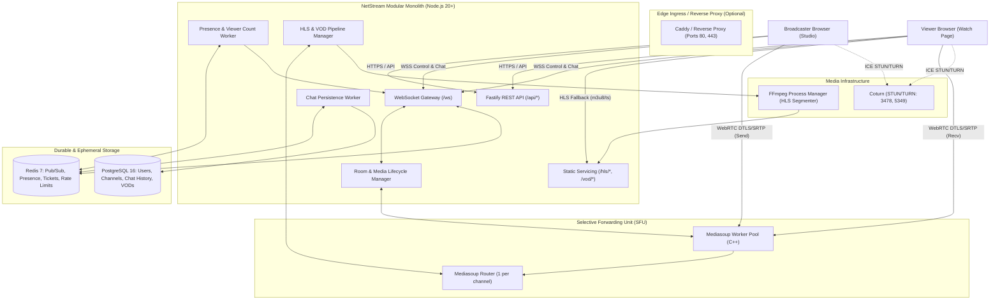
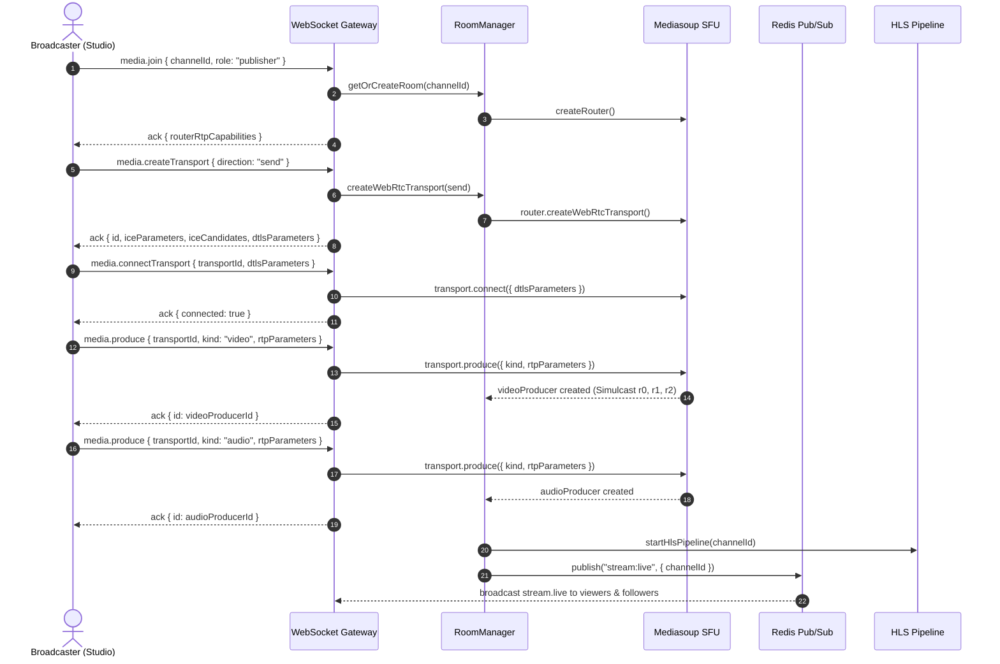
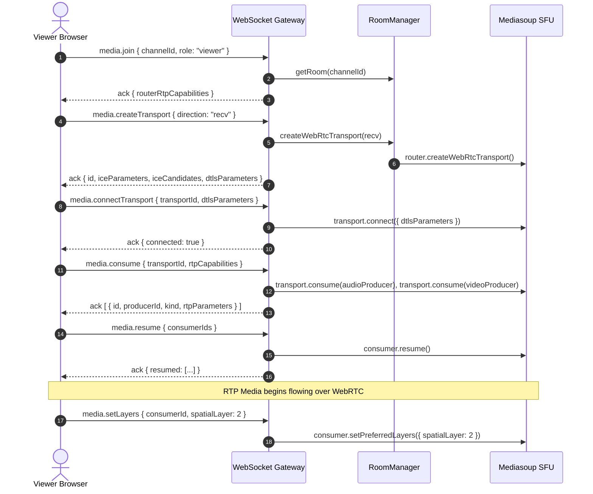
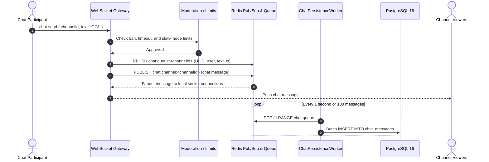
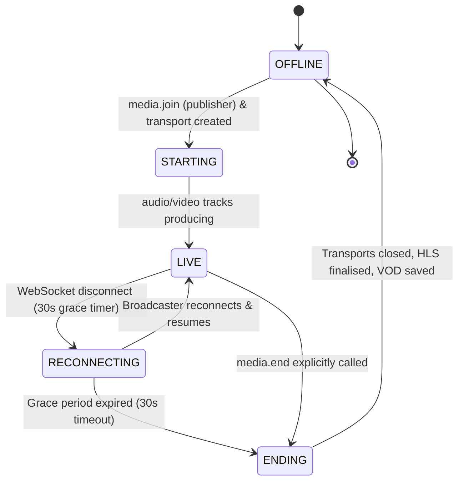
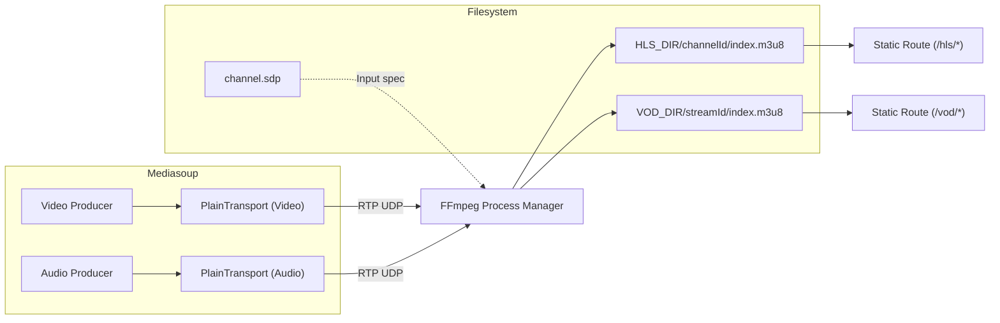

# NetStream Live Architecture

This document describes the architectural layout, component responsibilities, network ports, and state machines powering NetStream Live.

---

## 1. System Overview Diagram

---

## 2. Ports and Protocols Table

| Port Range | Protocol | Direction | Purpose | Component |
|---|---|---|---|---|
| `80 / 443` | TCP (HTTP/HTTPS) | Inbound | Web application & REST APIs | Caddy / Fastify |
| `3000` | TCP (HTTP/WS) | Inbound | Server dev port (API + `/ws`) | Fastify |
| `5173` | TCP (HTTP) | Inbound | Vite development dev server | React / Vite |
| `40000–40100` | UDP / TCP | Inbound | WebRTC media traffic (RTP/RTCP/DTLS) | Mediasoup SFU |
| `3478` | UDP / TCP | Inbound | STUN binding / TURN media relay | Coturn |
| `5349` | TCP (TLS) | Inbound | Secure TURN over TLS | Coturn |
| `49152–49252` | UDP | Inbound/Out | Coturn TURN relay port range | Coturn |
| `5432 / 5433` | TCP | Internal | Relational database connection | PostgreSQL 16 |
| `6379` | TCP | Internal | Cache, session tickets, pub/sub queues | Redis 7 |

---

## 3. Go-Live Signaling Sequence

---

## 4. Viewer Watch Signaling Sequence

---

## 5. Live Chat Flow & Persistence Architecture

---

## 6. Stream Lifecycle State Machine

---

## 7. HLS & VOD Pipeline Architecture

